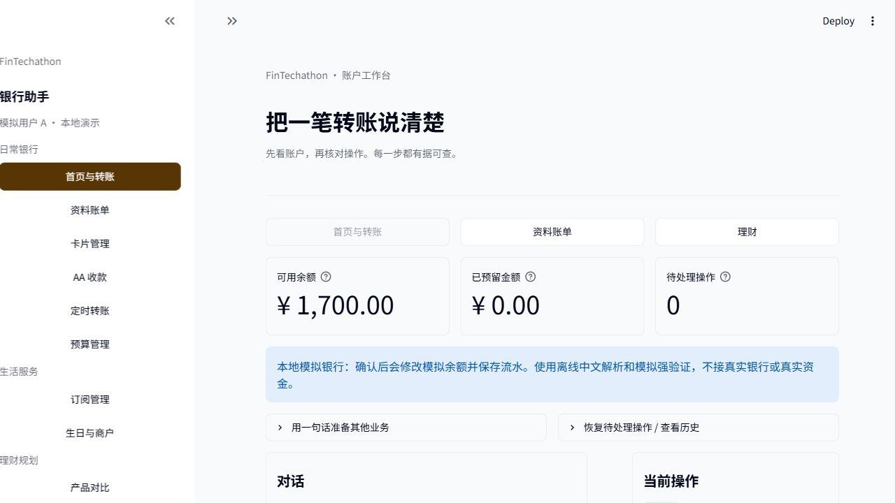
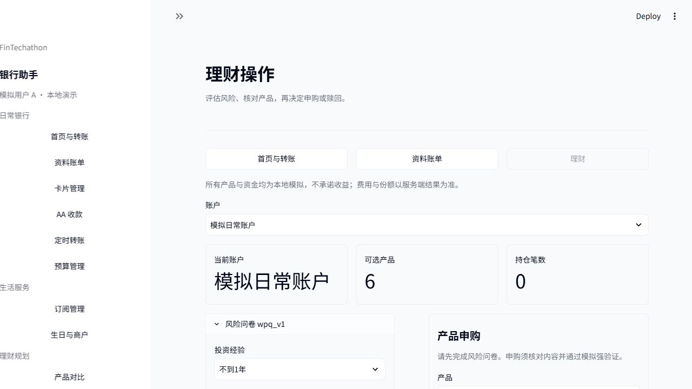
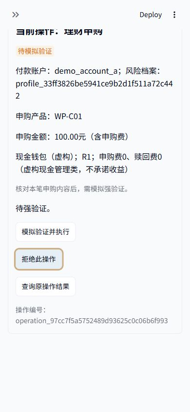

# 2026-10-21 UI 界面验收

本轮使用 ui-ux-pro-max、frontend-design、developing-with-streamlit，沿用现有模拟银行与已定规则，完成应用式 UI demo。首页、转账、理财重点调整，其余页面统一分组导航、标题和表单区域。

## 已交付

- 十页可进入；首页展示真实模拟余额、预留与待办，转账及理财保留确认和回执。
- 浅色纸面、深墨正文、黄铜主色，本机中文字体回退。没有外链素材、CSS覆盖或新增依赖。
- 理财问卷与申购分区，持仓与赎回单列；状态区区分待确认、待模拟验证、已完成、待核实。

## 实际检查

485项通过，0失败、0错误、0跳过：469项原有测试、12项组件测试、4项Codex真实页面验收。见[完整日志](evidence/2026-10-21-ui-full.txt)与[结果](evidence/2026-10-21-ui-full.json)。

普通沙盒343项通过，明确排除依赖本地回环的AppTest和Windows硬链接能力测试；这两类均在完整验收中经正式执行工具运行。沙盒系统临时目录、回环和硬链接限制的诊断记录已保留，没有降低业务保护或修改原测试断言。

DeepSeek自动中间测试存在unittest参数兼容问题，三次阶段测试未通过。原始冻结测试及日志保留；Codex完成最终审查、导航修正和受保护页面的展示接线，并独立运行验收。没有将模型自测作为独立通过。

浏览器已实际进入十个页面，完成200元模拟转账和100元模拟理财申购/强验证；导航前后业务表无变化，见[完整性记录](evidence/2026-10-21-ui-integrity.json)。1280、1024、390像素下主内容无横向溢出；手机表单重排，确认按钮和键盘焦点可用。此结论限本机浏览器环境。

独立工作区验收时，37个业务核心文件在统一Git换行后内容一致，主目录文件与日常数据库字节哈希未变。没有新增资金规则、真实银行或完整自由对话能力；R6-BE-01仍按BLOCKERS等待唯一资金方案结论。

设计token和接线细节见[UI设计与演示](UI设计与演示.md)。原业务修复证据保留在[10月20日复核报告](2026-10-20项目复核与修正.md)。

## 主目录同步验收

2026-10-21 用户明确授权后，已将审查后的25个文件同步到主目录；复制时逐文件核对SHA-256，全部与审查版本一致，并保留覆盖前备份。随后仅补充本节、设计文档同步状态及本次验收证据，没有提交或推送Git。

在主目录重新执行完整回归：485项通过，0失败、0错误、0跳过；见[主目录完整日志](evidence/2026-10-21-ui-primary-full.txt)与[结果](evidence/2026-10-21-ui-primary-full.json)。普通沙盒另行运行12项组件测试及Git差异检查，均通过。完整回归中需要本机回环和硬链接能力的测试仍通过正式执行工具运行，未更改测试断言。

37个业务核心文件的原始字节哈希、日常模拟库哈希及Git HEAD均保持不变，见[主目录同步完整性](evidence/2026-10-21-ui-primary-integrity.json)。本机8502预览已切换到主目录代码，继续使用独立演示库。正常启动沿用根README；原独立工作区及审查记录保留。
