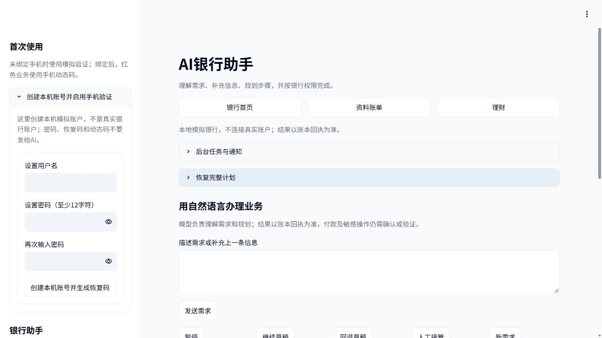

# 2026-10-26 待办恢复与全界面按钮验收

本次修复已在隔离版本通过独立验收，并按用户“同步已验收修复”的明确确认同步日常主目录。**主目录再次独立验收658项全部通过，0失败、0错误、0跳过；未提交、未推送。** 本轮AGENTS禁止自动copy主目录，因此同步前单独取得确认。主目录此前的635项验收保留其原版本含义。

## 问题与修复

日常库只读核查发现一条等待确认的 `subscription.list`。它是“查看订阅”查询请求；未结束时，全局保护会阻止新业务，因此 AI 输入/发送和卡片操作同时禁用。原页面处理入口不明显，跨页对象也可能保留已结束请求的旧快照。

候选版本在首页、AI和卡片页直接显示待办及原参数，提供查看、确认、拒绝、查询入口；处理完成后按服务端结果更新各页。敏感操作仍使用原强验证。真实身份的红色待办须到原业务验证区域输入手机动态码，普通确认不能代替验证。没有删除或自动处理用户的实际待办。

独立复核在完整实现后独立审查并修正了三类缺陷：确认前须展示可信对象/金额，核对失败时禁止批准；本地未知结果须由用户主动查询，不能刷新即消除；首页恢复非转账请求时不能按转账字段展示，待核实计数也须保留本地未知请求。已有技术规则与共享契约未因本次修复改动。

## 独立验收结果

| 范围 | 实际结果与边界 |
|---|---|
| 全量离线回归 | **658项通过**：当前635项项目测试、10项新增待办测试、13项额外页面按钮测试；0失败、0错误、0跳过。实际Streamlit AppTest和临时账本，离线套件禁止外部HTTP |
| 同步后主目录回归 | **同一658项再次全部通过**，用主目录模块与页面执行，183.62秒；日常库与模型配置指纹不变。日志及源码哈希为 `primary-independent.json/.txt` |
| 按钮覆盖 | 97处源码按钮定义全部渲染；96处有自动点击记录，余下 `app/ui.py:234` 页面内“银行首页”通过实际浏览器点击验证。逐项记录见 `button-coverage.json`，浏览器补充见 `browser-check.json` |
| 业务页面 | 覆盖转账/同名收款人、账单/资料、产品对比、卡片状态/限额/申请、AA、订阅扫描/核实/取消/提醒/续费、定时转账/取消、预算、生日商户、理财评估/申赎，以及导航/指南/模型设置/登录绑定恢复/后台启停/退出流程。按钮在既定前置条件下可执行；未知、锁定、权限不足时仍按规则禁用或拒绝 |
| 冻结测试复验 | 原阶段2和3的4项有效冻结测试由独立重跑通过；阶段1为占位烟雾断言，不计有效验证数，不作为通过依据 |
| 实际浏览器 | 独立8517进程与临时演示库，复现“查看订阅待办→AI禁用且说明原因→展示原参数→拒绝→输入与发送启用”；实际点击页面内导航返回首页。非逐像素全设备审查 |
| 当前版真实API | 5次新增请求、3组通过：待办解除后真实模型冻结及解冻、多轮补金额转账/刷新不重复调用付款、越权提示不付款。使用临时已绑定身份、真实TOTP算法和虚构账本；未使用用户本人的动态码 |

同轮前一候选版本另有真实模型7组通过，覆盖转账、账单、理财、卡片、订阅、生日和越权输入，见 `live-aggregate.json`。之后收到其他AI的页面文案、定时备注、手机验收入口改动，本轮已保留并重新执行658项全量检查及上述3组真实模型重点复验。前一版本7组证据保留各自源码哈希，**不冒称全部在最终哈希上重跑**。

真实API本轮累计 **18次**（包含连通性及此前失败/澄清请求），每次先保守预留0.25元，累计预留4.50元；按返回token量、全部输入以高峰未命中价计算，用量估算上界 **0.087698元**，低于用户授权5元。此为估算，不是服务商实际账单；未抵扣缓存优惠。定价依据：[DeepSeek官方价格](https://api-docs.deepseek.com/zh-cn/quick_start/pricing/)。本轮不再新增付费测试。源码开发委派调用与银行应用API测试分别记录，以上18次仅指应用API测试。

## 流程、并行改动与数据保护

- DeepSeek真实运行：`0e7cba1a-b1cc-4208-ad7b-8a6fbb3d99b0`，原Session与隔离worktree保持；独立验收并直接修正最终缺陷，未将DeepSeek自测当作独立验收。官方finalize已登记 `accepted_by_review`，并运行reporter；只接受隔离结果，不代表已合并或推送。
- 隔离路径：`.cache/ui-unblock-20261026/candidate`。10个结果文件已同步，前后哈希在 `sync-manifest.json`，授权执行记录在 `primary-sync.json`；同步前已再次核对主目录哈希，原文件备份于 `.cache/ui-unblock-20261026/primary-before-sync/`。其他AI已完成的文案、备注契约等改动已保留。
- 初次离线验收曾发现未知结果自动收口等回归，已修复并重测。合并后一次测试启动受沙盒回环连接限制而停滞，栈定位在Python事件循环创建，未进入页面；后经既有权限流程在正常主机测试环境执行，不降低业务断言。
- 首次主目录回归的3项失败是验收脚本将临时目录置于项目内，被手机验收入口的目录保护拒绝；只调整测试临时目录至系统临时目录，未修改业务保护或断言。原失败记录为 `primary-fixture-initial.json/.txt`，最终完整复验已通过。
- 在隔离验收及主目录回归期间，日常数据库与模型配置指纹均未改变。随后正常启动了原8501应用，启动状态文件按新进程更新；登录页加载会由既有 `Store.initialize()` 重写相同的 `PRAGMA user_version=16`，数据库整文件指纹因此变化。已用只读前后快照复核一次正常刷新：所有表的行数及内容摘要一致，文件差异仅为SQLite头部两个计数位置；不得把正常启动后的整文件指纹写成未变。原“查看订阅”仍为等待确认，用户待办未替其处理。`launcher.lock` 初始被占用无法读取，未声称其指纹验证通过。
- 日常8501健康检查返回200/ok，实际浏览器可打开并刷新登录页。已有身份要求用户自行登录，本次未收集密码或替用户登录；内页业务以658项临时身份/账本回归与真实API验收为依据。
- 凭证未打印、未保存明文、未发送给模型；API只发送虚构业务内容。测试不等于真实银行资金验证、安全认证或本人手机现场签收。

## 证据与执行命令

证据目录：[pending-ui-20261026](evidence/pending-ui-20261026/)。汇总为 `final-check.json`；源码指纹和完整输出为 `full-independent.json/.txt`，逐按钮记录为 `button-coverage.json`；当前真实请求与预算为 `live-pages.json`、`api-budget.json`，截图见下。执行过的测试脚本原文保存在 `executed-harness/`，其中 `.py.txt` 为原始审计副本，脚本当时从 `.cache/ui-unblock-20261026/` 运行。

```powershell
.\.venv\Scripts\python.exe -X utf8 .cache/ui-unblock-20261026/accept_candidate.py
.\.venv\Scripts\python.exe -X utf8 .cache/ui-unblock-20261026/live_pages.py resolve-pending-and-real-model-freeze,multiturn-transfer-and-rerun,injection-does-not-pay
.\.venv\Scripts\python.exe -X utf8 .cache/ui-unblock-20261026/finish_evidence.py
.\.venv\Scripts\python.exe -X utf8 .cache/ui-unblock-20261026/accept_primary.py
```

第二条命令产生付费请求，本轮已执行，不应为重看输出再次运行；查看现有JSON即可。第一、四条需要本机回环权限，但普通测试明确禁止外部HTTP。第三条为同步前证据整理命令，已完成，其主目录前置哈希对应同步前状态，不应在同步后重复运行。


