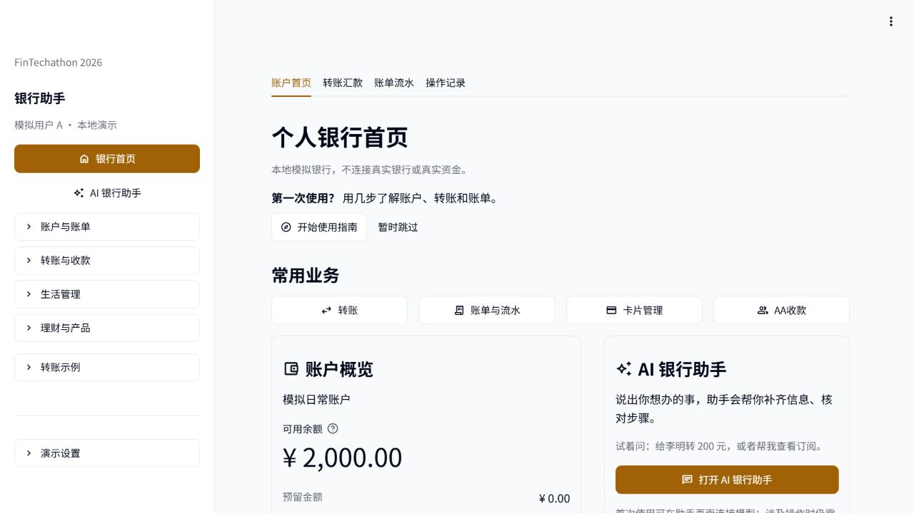
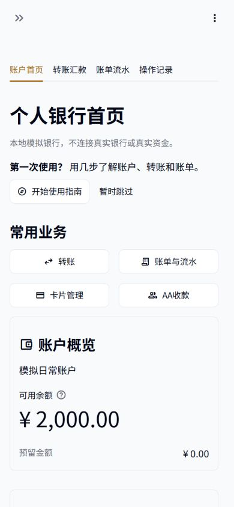
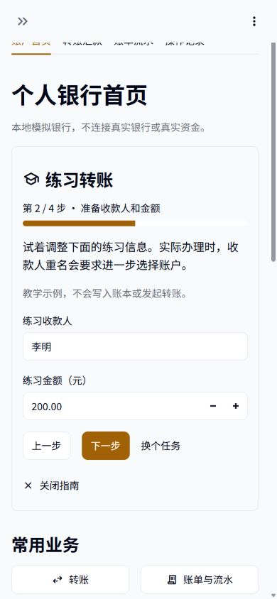

# 银行首页与首次使用指南

状态：用户已授权同步新版界面，21 个审查文件已备份后同步到主目录，主目录完整验收通过。独立预览仍为 http://127.0.0.1:8505/ 。未提交或推送 Git。

## 设计判断与审查

Design Read：面向首次使用者及演示操作者的个人银行改版，采用可信、清楚、克制的现代银行视觉，保留 Streamlit 原生交互。

采用 Taste Skill 的改版审查与视觉约束、Frontend Design 的层级设计、UI/UX Pro Max 的金融与引导规范、Streamlit 1.65 本机文档。Taste 的营销页动效、图库与大型 hero 不适用于银行业务页。DESIGN_VARIANCE=4，MOTION_INTENSITY=2，VISUAL_DENSITY=4；优先可读性、键盘与手机操作。

当前审计：原首页将八项业务等权平铺，账户的三个字段同等强调；AI 助手只在侧栏末端，导航有十余个平铺按钮；使用说明是一段折叠文字。保留真实账户、待办、流水、已审查色板、原始交易流程与路由，重做首页层级、侧栏分组及任务指南。没有品牌资产或 SEO 路由迁移需求。

色板为深墨 #020617、纸白 #F8FAFC、白 #FFFFFF、次字 #475569、边框 #E2E8F0、单一黄铜强调 #A16207；状态沿用明确语义色。字体沿用 IBM Plex Sans、本机中文无衬线回退。圆角统一 8px。文字左对齐；标题、账户金额、操作区和辅助说明使用明确字号层级。

```text
分组侧栏                  账户首页 | 转账汇款 | 账单流水 | 操作记录
银行首页 / AI 银行助手     个人银行首页       使用指南（可跳过）
账户与账单                常用业务：转账、账单、卡片、AA
转账与收款                账户概览           AI 银行助手
生活管理                  名称、可用余额     能办什么 / 示例 / 打开
理财与产品                预留金额
                          更多服务（展开）
                          待处理事项         近期交易
```

自审：沿用色板是为了保持已验证对比度和业务页一致性；视觉变化由布局与节奏承担。账户和 AI 两块有不同内容职责，避免把全部信息做成等权卡片。首页不使用装饰插画、伪造收益、宣传语和巨型标题。手机端账户、助手及列表依次堆叠，快捷操作两列；侧栏分组折叠以减少第一次看到的入口数量。

## 银行参考与取舍

- [汇丰香港官方界面](https://www.hsbc.com.hk/zh-cn/ways-to-bank/mobile-apps/banking/features/)：固定业务位置、快捷操作和账户概览。
- [Chase 官方演示](https://www.chase.com/content/chase-ux/en/personal/zelle.transcript.html/6375111027112)：支付、转账、收款按任务集中组织。
- [星展官方互动指南](https://www.dbs.com.sg/personal/digital-banking/digibank-app-demo)：先选要学的业务，分步练习，允许随时重学。
- [招商银行官方截图](https://apps.apple.com/cn/app/招商银行/id392899425)：按理财、贷款、收支等场景区分内容。

只参考布局组织，没有复制标志、图片、代码、账户信息或银行业务规则。

## 交互边界

指南只使用独立 UI 状态，提供任务选择、前进、后退、关闭、跳过与重播。练习中的姓名与金额明确标为教学数据，不创建业务请求、不调用模型、不写账本。完成指南和确认交易是独立动作。进入业务后，仍由原流程执行确认、模拟强验证和未知结果恢复。指南状态在本次浏览器会话内保留；新会话可再次出现提示，不写入银行用户资料。

首页数据来自 HomeData，None 与空集合保持不同显示。AI 页面只在用户明确操作后请求模型。所有原业务页面、输入 key、确认、拒绝和重置保护保持；不引入新依赖、CSS、HTML 或外链资源。

## 实际验收

制作与独立验收由 Codex 执行，依据用户对本轮直接开发的明确授权。DeepSeek 委派因读取与调用上限停止，未产出修改，不能作为完成证据。

- 独立预览与同步后的主目录分别完成完整回归，均为 **554 项通过，0 失败、0 错误、0 跳过**，包含最新安全和模型代码，以及新增 7 项界面和指南验收。此处的[结果与源码哈希](evidence/ui-bank-20261023/full.json)、[完整日志](evidence/ui-bank-20261023/full.txt)为主目录实际执行记录。运行命令：项目 Python 执行 `-B -X utf8 scripts/verify_ui_redesign.py`；脚本使用独立临时库，检查日常库不变，不覆盖其他阶段证据。
- 真实 AppTest 覆盖练习输入、后退保留、完成、重播、关闭、跳过、目标页面、侧栏与 AI 入口；对全部银行表比较前后内容。待确认及超时后的 unknown 原请求、锁定和查询恢复均保留，查询不会再次付款。原有业务回归一并通过。
- 浏览器实际走完转账教学，编辑教学收款人、核对、完成并打开转账页；页面仍等待新的真实办理输入。320、390、768、1280 CSS 像素宽度下无根页面横向溢出；手机常用操作两列。键盘焦点可见且未被遮挡。[浏览器检查](evidence/ui-bank-20261023/browser-checks.json)。这些是自动化与本机浏览器检查，不冒充真人用户研究、生产认证或独立无障碍审计。
- **39 个业务与安全核心文件哈希一致**；主脚本 4 个业务函数、11 处受保护调用和 6 处禁用条件 AST 一致。同步仅涉及授权文件，其他已有改动及日常库保持。[完整性检查](evidence/ui-bank-20261023/integrity.json)分别记录同步前审查及同步后主目录核对。
- Taste 适用项检查：单一浅色主题、沿用可读色板、8px 圆角、本机字体、Material 图标、H1/H2 标题层级；无新增自定义动效、外链资源、装饰图库、假余额或假回执。桌面 CTA 单行，窄屏可换行排列，原生键盘焦点保留。使用原生 viewer 工具栏隐藏部署等开发入口。
- 本轮没有新增真实银行模型验收请求；此前 F1/F2 的真实模型结果仍见原报告，不把它写成本轮 UI 的新实测。10 月 21 日的旧 UI 数量保留为历史。

同步前原文件备份保留在本机任务产物目录 `ui-bank-redesign-20261023/primary-backup-20261023T132904`，另保留同步前后哈希清单。同步后的主目录完整回归用时 78.760 秒，退出码为 0；未执行 Git 提交或推送。预览使用独立模拟库，主目录启动后使用其原有日常模拟库。




