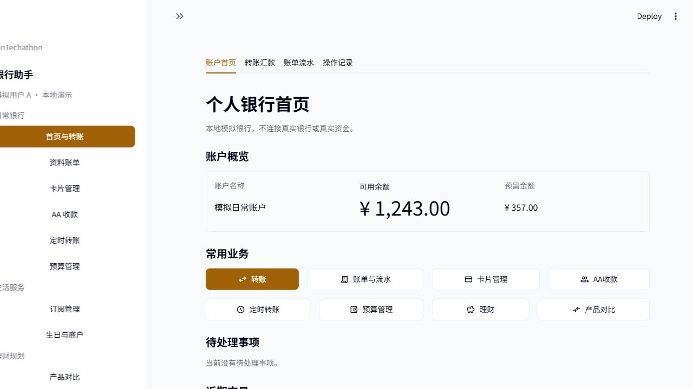
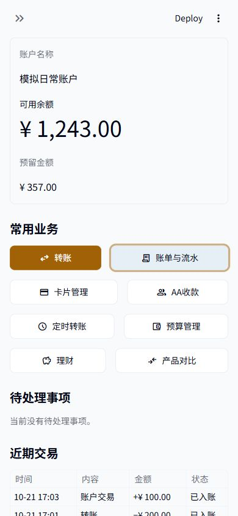

# 银行首页改版

2026-10-23 任务引导与首页新布局见 [银行首页与首次使用指南](UI银行改版与引导.md)。home_view 新增 assistant 返回动作，由主脚本导航至 pages/0_AI银行助手.py；show_header=False 供主脚本在指南前统一显示标题。以下为 10 月 21 日已验收版本的历史记录。

状态：独立工作区审查后，经用户明确授权同步主目录；主目录496项完整回归通过。未提交或推送Git。

## 设计与当前问题

旧首页把转账聊天、账户统计、重复导航及历史恢复放在同一层级，服务入口落在首屏下方。新版以个人银行首页为入口，分别提供账户首页、转账汇款、账单流水、操作记录四个原生标签页。首屏先展示账户与常用业务；输入、确认和历史恢复各有位置。

参考[招商银行官网](https://www.cmbchina.com/)的服务分类，以及[汇丰网银介绍](https://www.hsbc.com.hk/ways-to-bank/internet/)的账户与交易概览。只参考组织方式，没有复制银行品牌、素材、代码或产品规则；未访问真实客户后台。

沿用当前主题：纸白`#F8FAFC`、深墨`#020617`、黄铜`#A16207`、白色内容面`#FFFFFF`、次要文字`#475569`、边框`#E2E8F0`。使用已有本机中文无衬线字体回退，原生字号与键盘焦点；不加载外链素材、不加CSS、不引入依赖。

```text
账户首页 | 转账汇款 | 账单流水 | 操作记录
个人银行首页
本地模拟性质说明
账户概览：账户名称 / 可用余额 / 预留金额
常用业务：转账、账单与流水、卡片管理、AA收款
          定时转账、预算管理、理财、产品对比
待处理事项：真实数量、待确认/待验证/待核实信息
近期交易：最近30天范围内的最近3条已入账流水
使用说明（折叠）
```

自审后删掉正文第二套三项导航、重复空待办区和面向开发者的首页文案。服务用原生横向可换行容器；转账是唯一主色按钮，其余保持普通按钮。桌面与手机需实际浏览器核对，不能由fake组件测试推断。

## 展示接口与接线

`app/home_view.py`是纯展示模块，只导入标准库与Streamlit，不访问会话、银行、数据库、认证或导航。`render_home(HomeData(...))`返回点击入口的action_id，未点击返回None，不执行或确认业务。

- `AccountSummary(name, balance_text, reserved_text)`：调用方提供已格式化的可用余额及预留金额。
- `TransactionSummary(title, time_text, amount_text, status_text)`：调用方提供交易描述、上海时间、带方向的金额和账本状态。
- `HomeData(account, pending_count, todo_items, transactions, notice)`：None表示未取得/查询失败，空集合表示查询完成且无记录；两者分别显示暂不可用或空状态，不能补造0或成功。

| action_id | 按钮 | 最终落点 |
|---|---|---|
| transfer | 转账 | 主脚本“转账汇款”，保留原中文输入、确认、模拟验证和恢复 |
| bills | 账单与流水 | 主脚本“账单流水”，读取当前模拟账户真实账本 |
| cards | 卡片管理 | pages/3_卡片管理.py |
| aa | AA收款 | pages/4_AA收款.py |
| scheduled | 定时转账 | pages/6_定时转账.py |
| budget | 预算管理 | pages/7_预算管理.py |
| wealth | 理财 | pages/9_理财.py |
| products | 产品对比 | pages/2_产品对比.py |

“资料账单”仍由侧栏进入pages/1_资料账单.py；它与当前模拟账户账本是不同的数据入口，不将会员资料流水当作当前模拟账户流水。订阅管理、生日与商户继续通过侧栏访问。

受保护的主脚本由Codex最终接线：原资金动作、确认、拒绝、模拟强验证、未知结果恢复、重置保护和控件key不变，仅增加展示选择状态。标签页点击、服务按钮和导航均不自动创建业务请求；执行仍须原流程明确操作。原有控件在各标签内正常渲染，不以隐藏视图当作权限保护。

## 验收边界

DeepSeek生成独立展示模块、标准库fake组件测试及初稿文档，broker阶段测试通过。Codex独立审查后调整移动按钮换行、用户文案、重复空状态和可用余额展示，并接入现有转账、账单、历史和其他页面。

组件测试检查真实点击返回、空值与未知状态、重复渲染不改数据和展示边界。真实AppTest另外检查八个服务入口、返回导航、待确认状态、查询失败和原资金保护。浏览器检查实际可见布局与键盘/手机行为；完整测试与证据完成后另附实际结果，不将fake测试称作浏览器验收。

既定业务规则及BLOCKERS不因UI改版而改变；当前仍是本地模拟银行和有限中文解析，不宣称真实银行、真实资金、全场景自由对话或后台自动执行能力。

## 实际验收结果

- Codex独立完整回归：496项通过，0失败、0错误、0跳过；[完整日志](evidence/2026-10-21-home-full.txt)、[结果](evidence/2026-10-21-home-full.json)。包含原485项与新增8项展示组件、3项真实页面验收。
- 普通沙盒351项通过；明确排除AppTest和Windows硬链接能力测试，两类均在完整验收中实际执行。首次普通组误将复用AppTest帮助方法的新模块当作普通测试，遇到本机回环限制而停止；测试分类已标明，原中断日志保留，没有削弱测试或业务保护。
- 浏览器实际验证首页转账入口与账单标签切换；手机服务两列、键盘焦点可见；320/390/768/1280像素页面宽度无横向溢出。限本机浏览器环境，不代替真人易用性反馈。
- 独立工作区验收时，37个业务核心文件内容一致；原主目录28个UI文件、Git HEAD与日常库哈希未变。11处受保护资金/验证调用和4处按钮禁用条件AST相同；预览导航前后独立模拟库哈希一致。见[完整性记录](evidence/2026-10-21-home-integrity.json)。
- 独立工作区原预览为本机8504端口；授权同步后的主目录预览切到8502，继续使用独立模拟库。上一版UI与业务证据见[10月21日UI验收](2026-10-21UI界面验收.md)。




## 主目录同步验收

2026-10-21用户明确授权后，13个审查文件逐个核对SHA-256并同步；保留覆盖前备份，随后补存本节与3份主目录验收证据，未提交或推送Git。完整回归在主目录再次执行496项，0失败、0错误、0跳过；[主目录结果](evidence/2026-10-21-home-primary-full.json)、[主目录日志](evidence/2026-10-21-home-primary-full.txt)。普通沙盒另行8项组件测试和Git差异检查通过。

37个业务核心文件、日常库和Git HEAD保持不变；原有未提交UI文件中只有本次授权覆盖的README、主脚本与导航验收测试被替换，其余保持原哈希。见[主目录同步完整性](evidence/2026-10-21-home-primary-integrity.json)。预览 http://127.0.0.1:8502/ 已实际打开主目录个人银行首页，使用原有独立模拟数据。


## 2026-10-28 操作统一改造

以下为本轮新路由，历史数字与图示保留原时点。本轮已完成独立验收并按明确授权整合本地main，详见[银行操作统一验收](2026-10-28银行操作统一验收.md)。

主导航为首页、转账与收款、收支明细、理财、我的，AI银行助手保持全局入口。业务页默认只提供返回首页；显式传入 keys 仍支持原 render_app_nav 多入口 API。

| action_id | 按钮 | 最终落点 |
|---|---|---|
| transfer | 转账 | 主脚本转账与收款 |
| bills | 收支明细 | 主脚本收支明细 |
| cards | 卡片管理 | pages/3_卡片管理.py |
| aa | AA收款 | pages/4_AA收款.py |
| scheduled | 预约转账 | pages/6_定时转账.py |
| budget | 预算管理 | pages/7_预算管理.py |
| wealth | 理财 | pages/9_理财.py |
| products | 产品对比 | pages/2_产品对比.py |
| subscriptions | 订阅管理 | pages/5_订阅管理.py |
| merchant | 生日计划 | pages/8_生日与商户.py |
| mine | 我的 | app/pages/10_我的.py |

render_home 仍只返回动作；名称、余额和回执仍由可信调用方提供。金额统一用元，既有整数分、身份与授权机制不变。
