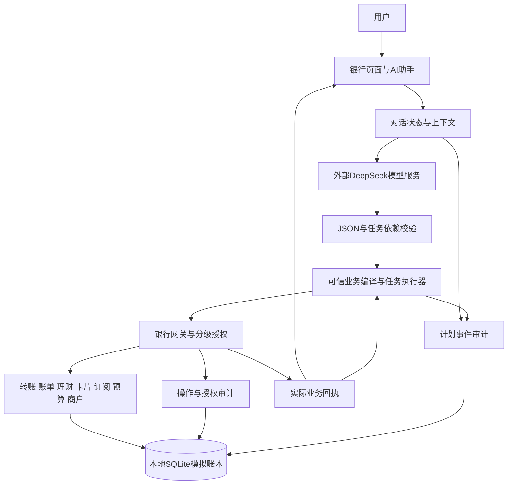

# 银行 AI 智能体技术文档

材料版本：v0.1，2026-10-23。编写者：A / Codex。适用范围：Windows本地模拟银行演示。源码定位为Git基线`02fe7464c9b131a3b18722bd9df85a54227a0ee1`及当日已有未提交改动；不能仅凭该提交号复现当前实现。关键文件哈希、证据对应关系及本次文档检查见[材料检查记录](材料检查记录.json)。

## 1. 目标与实现范围

系统将自然语言需求转为结构化业务草稿，补充缺失信息，并将复杂需求拆成有依赖的任务。业务动作进入统一网关，按操作类型和当前状态执行查询、确认或模拟强验证，最后展示实际回执。

当前六类场景的实现范围如下。

| 场景 | 已实现内容 | 演示边界 |
|---|---|---|
| 智能转账 | 姓名或手机号解析、同名消歧、单笔转账、定时任务、AA收款单 | 定时任务需手动检查，到期重新授权；AA创建收款单不代表已收款 |
| 账单分析 | 上海日期口径的分类及期间统计、退款另列、大额单笔提示 | 异常提示只启用既定大额单笔规则，不能据空列表判定无风险 |
| 理财 | 产品对比、问卷评分、风险匹配、申购、持仓、赎回 | 虚构产品与固定模拟净值；赎回即时入账模拟T+1，无真实跨日结算队列 |
| 卡片 | 申请受理、限额、冻结、解冻、挂失、解挂 | 申请受理不代表真实审批或发卡 |
| 订阅 | 流水识别候选、核实、排除、取消、每期续费、本地提醒 | 续费每期单独强验证；提醒需手动检查，无后台自动扣费引擎 |
| 生日联动 | 日期计划、预算预留、选卡下单、剩余金额释放、暂停及接管 | 订单与地址均为模拟；程序关闭后不会自动完成生日下单或真实配送 |

依据：[项目说明](../../README.md)、[六场景验收](../2026-10-23安全收口与六场景最终验收.md)、[接口指南](../接口约定与接入指南.md)。

## 2. 系统架构

页面使用Python和Streamlit，模拟账本使用SQLite；当前页面依赖固定为Streamlit 1.65.0，共享JSON接口版本为1.1，存储版本为13。首个交付目标为Windows / Python 3.12，干净环境交付复现仍属后续F3工作。

| 组成 | 主要职责 | 实现入口 |
|---|---|---|
| 页面 | 展示账户、需求草稿、任务、授权及回执；提供使用指南 | [页面入口](../../app/main.py)、[AI面板](../../app/model_bank_panel.py) |
| 对话 | 多轮补充、改参、草稿状态、暂停、回退和接管 | [对话状态](../../agent/model_dialogue.py) |
| 模型传输 | 配置读取、受限地址、JSON请求、响应与错误检查 | [模型客户端](../../agent/model_client.py) |
| 计划编译与执行 | 将允许的意图映射到既有业务动作，按依赖推进 | [计划执行](../../agent/model_bank.py) |
| 银行网关 | 身份、对象归属、业务重验、授权、幂等、事务及恢复 | [执行网关](../../bank/gateway.py)、[会话控制](../../agent/controller.py) |
| 业务与数据 | 资金、预算、商户、理财、订阅及持久化状态 | [数据库](../../bank/store.py)、[服务](../../bank/services.py) |
| 契约与权限 | 字段、类型、状态及绿黄红分级 | [共享契约](../../shared/contracts.py)、[权限计算](../../shared/policy.py) |

模型服务接收用户需求和当前授权范围内的业务上下文，返回声明式JSON。模型响应作为不可信输入处理，不能直接访问数据库、调用主机命令或发放授权。模型请求会出本机，当前仅使用虚构资料；本地SQLite不意味着全部数据都保留在本机。

## 3. 意图理解与任务规划

### 3.1 多轮需求处理

对话协议包含澄清、单项草稿、多项计划和不支持四类结果。槽位只接受允许的业务信息，例如账户、收款人描述、金额、时间、产品及业务编号。缺金额、同名收款人、缺问卷答案或其他歧义进入补充流程。

用户改金额或对象时，系统更新未执行草稿；切换业务时不继承无关槽位。“继续”“已确认”等自然语言不能替代银行授权。问卷要求逐题明确答案，一句“保守”不能转换成五题答案或风险评分。

### 3.2 计划校验与依赖执行

每个计划最多20步。任务包含编号、意图、业务参数和依赖列表。系统检查编号唯一、依赖存在、图无循环，再按依赖就绪顺序排列。执行器重新检查同一组约束，避免绕过对话入口直接提交非法计划。

每一步根据当前可信资源编译为既有接口动作。跨步骤引用只接受成功前置回执中的预留编号或风险档案编号，且必须来自依赖祖先；不能凭模型文字虚构。任务状态由程序根据回执维护。

查询可按允许范围自动推进；其他动作先由用户准备，再进入网关原有授权。前序失败、拒绝、未核实或审计失败时阻止继续依赖步骤。`scheduled`仅表示登记成功，不等于已到期付款。暂停和人工接管停止后续推进，已入账交易仍保留原结果；草稿回退不提供交易撤销能力。

### 3.3 结构与资源边界

| 边界 | 当前值或处理 |
|---|---|
| 用户单次需求 | 1—1000字符 |
| 计划任务数 | 1—20步 |
| JSON容器深度与节点 | 深度最多16，节点最多4096 |
| 草稿文本 | 最多30000字符，重复键和不合法JSON拒绝 |
| 对话历史 | 条目上限32，默认12；历史JSON累计上限24000字符 |
| 模型HTTP请求与响应 | 请求最多64KiB，响应最多256KiB |
| 默认模型请求超时 | 45秒，无自动请求重试 |
| 连续异常 | 模型草稿连续5次异常停止本会话；核实后可用“新需求”重开 |

依据：[对话状态](../../agent/model_dialogue.py)、[结构边界](../../agent/model_safety.py)、[模型客户端](../../agent/model_client.py)。这些限制减少已覆盖的资源与执行风险，不等同于完整服务级防滥用或主机隔离。

## 4. 主要业务算法与一致性

### 4.1 资金、重复请求与未知结果

金额使用整数分；账本保持“余额＝可用金额＋预留金额”。转账日累计由可信账本计算，覆盖同一用户不同付款账户，并在执行阶段处理并发和授权期间变化。含本次累计不超过1000元进入黄色确认，超过1000元进入红色模拟强验证。

写操作绑定幂等键：同键同内容返回原结果，同键改内容拒绝。服务端事务关联资金变化、订单、流水、操作结果与审计，失败按相应事务或保存点回滚。客户端收到超时不能据此判断未扣款；结果`unknown`时保留原动作和原键，查询可信状态后恢复。查无记录本身不证明原动作没有执行，不能自动换键付款或释放可能已消费的预算。

### 4.2 账单与订阅识别

账单按上海日期聚合，消费和订阅借方计入毛支出，退款贷方另列，收入、转账和理财不计入消费毛支出。大额提示针对消费、订阅、转账和理财借方单笔金额达到5000元的记录。其余借贷配对、跨期退款归属、收益率等规则未启用。

订阅候选按账户与商户归组，至少两期符合条件的消费或订阅借方流水才进入周期检查。按首期锚日推算自然月或年周期，短月截断至月末；日期容差±3天，相邻金额差不超过前一期金额的5%。满足时生成候选和依据，重复扫描不重复创建，已取消商户不会由扫描自动恢复。候选核实、排除、取消和续费各有独立含义，识别本身不扣款。

依据：[账单计算](../../billing/__init__.py)、[订阅识别](../../subscription/__init__.py)、[每期续费](../../bank/subscription_charge.py)。

### 4.3 理财评分与费用份额

问卷版本`wpq_v1`要求五题全答，每题1—4分，合计5—20分；5—8、9—12、13—16、17—18、19—20分别映射R1—R5。缺题、额外题号、非法选项或版本不匹配均拒绝。申购前核对产品存在、风险匹配、起购金额和可用余额；赎回核对持仓归属、锁定、份额及到账后金额范围，执行时再次检查。

费用使用Decimal按基点计算并四舍五入到整数分；申购份额按净申购金额除以每份净值，四舍五入到四位小数。赎回先将份额乘以模拟净值取整到分，再计算赎回费并得到净到账。当前不计算真实市场净值波动或承诺收益。

依据：[问卷评分](../../wealth/questionnaire.py)、[理财实现](../../bank/wealth.py)、[虚构产品目录](../../wealth/catalog.py)。

## 5. 跨场景实例

下表以独立临时模拟账户期初200000分为例，沿用真实模型birthday验收的金额组合，说明资金关系。页面连续六场景验收还有前序转账，期初不同，不能将两组余额混用。

| 阶段 | 余额（分） | 可用（分） | 预留（分） | 含义 |
|---|---:|---:|---:|---|
| 初始 | 200000 | 200000 | 0 | 独立模拟账户 |
| 确认预留35700分 | 200000 | 164300 | 35700 | 预留不减少总余额 |
| 强验证后下单19900分 | 180100 | 164300 | 15800 | 原子写入订单与消费 |
| 确认可释放的剩余15800分 | 180100 | 180100 | 0 | 已核实可释放部分回到可用 |

每一步都须取得实际回执。用户在预留后暂停，不会自动下单；订单结果未知时先查原订单，不直接释放对应资金。以上是模拟业务，不表示真实鲜花购买或配送。

原始依据：[F1/F2报告的真实模型分组](../2026-10-23安全收口与六场景最终验收.md)、[真实模型结果](../evidence/2026-10-23-F12-live.json)；数值关系亦由本次材料检查复算。

## 6. 安全设计

安全控制位于可信程序。网关独立计算权限、校验身份和资源归属、核对操作摘要与有效期，并在授权时重新检查业务状态。模型不能提供用户身份、已确认标志、强验证凭证、风险等级或直接执行内部资金动作。

黄色操作需明确确认；红色操作需有效模拟验证凭证，普通确认不能降级放行。挑战有效期10分钟，凭证与用户、动作、参数及操作键关联，错误验证累计5次锁定本次操作。模型异常会话熔断与银行验证锁定分别维护。

模型计划请求、接受或拒绝、控制动作及执行步骤有闭集事件审计；可信程序生成跟踪号并关联银行操作。审计不收原始提示、自由文案、密钥、验证码或验证令牌。审计不可用时停止新的计划推进，已提交交易仍保留事实。SQLite审计不是不可篡改的外部证据存储。

系统使用有界JSON、闭集工具及可信编译器形成逻辑隔离，不运行任意模型生成代码，也没有独立OS沙箱。详细权限表、已验证攻击及剩余风险见[安全自评报告](06-安全自评报告.md)。

## 7. 已有验证与证据范围

下表引用已有执行记录。本次材料整理没有重新运行这些业务测试或新增真实模型调用；本次检查仅复核记录、当前源码哈希、链接与文档数值。

| 验证 | 保存的实际结果 | 与当前文件的关系 |
|---|---|---|
| 最新界面版完整回归 | 554项，0失败、0错误、0跳过 | [摘要](../evidence/ui-bank-20261023/full.json)记录的108个源码哈希与本次当前文件全部一致 |
| F1/F2完整回归 | 547项，0失败、0错误、0跳过 | 历史安全与六场景版本，已包含于后续完整回归，不与554相加 |
| F1/F2真实DeepSeek | 9组11次，保存记录全部通过 | [原始记录](../evidence/2026-10-23-F12-live.json)的148个文件中5个界面或测试文件已变化；对应版本和模型实测范围保留，不能写成新版界面重新做过真实模型验收 |
| 新版界面完整性 | 39个业务与安全核心文件未变，受保护调用与禁用条件核对一致 | [完整性证据](../evidence/ui-bank-20261023/integrity.json)，属于当次同步审查 |

覆盖包含正常流程、拒绝、重复、未知结果恢复、越权、并发、事务回滚、计划注入和锁定等指定用例。自动化页面测试与真实模型测试分开，不等于全部自然语言、页面组合或攻击方法均已验证。

## 8. 交付及后续变化

当前材料可以作为参赛正文底稿；干净环境安装与启动复现、正式PPT、实际演示视频及最终发布核对仍待完成，参见[固定计划](../下一阶段分工与实施计划/README.md)。源码包不能携带私有配置、密钥、日常账本或本机虚拟环境。

后续界面配色或排版一般仅影响展示素材；新增或删除业务会影响第1节和简介；模型协议、规划或数据流变化影响第2—3节；金额、评分或周期规则变化影响第4—5节；身份、权限、密钥、审计、网络或隔离变化影响第6节和安全自评。任何行为变更都需要按实际影响重新验证，第7节仅更新为真实取得的新证据。最终提交时同时固定源码与材料版本。
