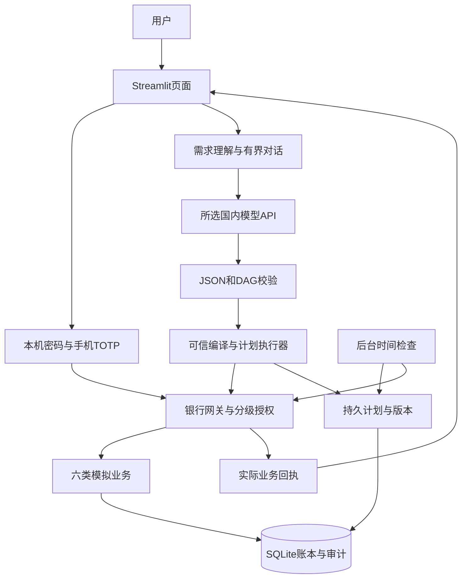

# 言行银行AI智能体技术文档

安装发布状态已追加[1.0.0补充说明](07-安装发布补充说明.md)；下方及Word v0.4保留本体修复时点，安装暂缓等旧表述以补充为准。

项目全称：言行——融合任务规划与分级授权的多场景银行AI智能体。材料版本v0.4，2026-10-26。当前实现为Windows本机单用户、Python/Streamlit/SQLite模拟银行；Git基线`285c90c6014158b85d8323788945b085d1991192`加已验收修复及本轮未提交改动，具体版本以[检查记录](材料检查记录.json)为准。

模型负责理解、追问和提出结构化计划；可信程序负责资源核对、授权与执行。定时计划修订与后台租约两处缺陷已修复并通过主目录验收。本轮定时备注已补齐，并完成DeepSeek当前版本在线验收；具体覆盖与限制见本次记录。

## 1 实现范围

| 场景 | 已有能力 | 当前边界 |
|---|---|---|
| 转账 | 姓名/手机号解析、消歧、单笔、定时登记、AA收款单 | 到期重新授权；AA建单不等于收齐；单笔与定时自然语言备注均贯穿登记、确认、执行与恢复 |
| 账单 | 分类统计、月/年期间、退款另列、大额单笔提示 | 异常识别是既定规则，不是完整欺诈识别 |
| 理财 | 产品对比、逐题评估、风险匹配、申购、持仓和赎回 | 虚构产品/净值，模拟T+1，无真实市场及跨日结算服务 |
| 卡片 | 申请受理、限额、冻结/解冻、挂失/解挂 | 受理不代表银行审批或发卡 |
| 订阅 | 流水识别候选、核实/排除、取消、每期续费、到期提醒 | 续费单独验证；通知为应用内记录，未接外部商户 |
| 生日联动 | 日期计划、预算预留、模拟下单、释放；专门表单登记定时链 | 完整自然语言草稿可生成带时间约束的预算与采购链；缺信息须补充，到期仍需授权 |

## 2 架构与版本

页面依赖Streamlit 1.65.0、pyotp 2.10.0、qrcode 8.2；默认业务接口v1.1，真实TOTP交易兼容v1.2，存储版本v16。当前部署范围为Windows本机，常用入口为`启动银行助手.py`，监听回环地址；已有依赖环境与全新机器安装验收分别记录。

代码入口：[对话](../../agent/model_dialogue.py)、[计划执行](../../agent/model_bank.py)、[网关](../../bank/gateway.py)、[认证](../../bank/auth.py)、[计划存储](../../bank/plan_store.py)、[后台](../../bank/worker.py)。后台只能准备和查询业务，不能批准付款。

## 3 多服务商模型API

设置页支持DeepSeek、智谱GLM、通义千问、豆包、Kimi，并支持受限格式的自定义模型ID。官方HTTPS地址按服务商白名单匹配；本地兼容服务限字面回环地址。禁止重定向和服务商/地址不匹配；当前默认模型与环境变量见[注册表](../../agent/model_providers.py)，不把预设名单当作实时可用性证明。

密钥按服务商绑定。当前本地仅保存一份活动配置；切换服务商须提供对应密钥，不能混用原密钥。Windows DPAPI用于静态加密，读取时仅在进程中解密；旧v1配置按DeepSeek兼容。可选桌宠凭据复用仅用于DeepSeek；独立配置可不依赖桌宠。显式环境配置优先，具体行为见[接入说明](../AI模型接入与验收.md)。

传输只接受完整JSON响应，不开放模型工具执行，不自动重试付费请求。模型请求会携带用户输入及允许的业务上下文出本机，因此当前仅使用虚构数据。验证码、恢复码和模型密钥不得输入普通聊天。

GLM、千问、豆包、Kimi有离线协议/配置/页面证据，本轮没有新增真实调用。本轮DeepSeek当前代码11组检查、11次真实请求通过；旧F1/F2的9组11次另行留档。银行侧仍为临时模拟账本与测试授权，不能替代用户手机验收。

## 4 任务规划与恢复

模型响应分为澄清、单项草稿、多项计划和不支持；缺金额、对象、日期、问卷答案时补充，不根据一句风险偏好代填五道问卷。计划最多20步，校验编号唯一、依赖存在、无环，并仅允许引用成功祖先回执中的预留或风险档案编号。

执行前从可信资源编译业务请求，再由网关核验。PlanStore持久化任务、依赖、回执、等待/暂停状态、资源选择和版本；已完成步骤不能删除、改号或改内容后当成新付款。重启恢复先查询原操作，原键重试，不根据超时推断未付款。定时登记成功不代表付款成功，依赖需等待实际业务结果。

草稿回退、暂停、接管不撤销已入账交易。修订继承未改变的可信时间、已完成事实与已准备操作；预算金额修订保留自定义时间。无法安全合并或发生版本冲突时拒绝新草稿并保留原计划，不以新操作替代旧交易。

| 技术边界 | 当前实现 |
|---|---|
| 单次输入 | 1—1000字符 |
| 任务数 | 1—20步 |
| JSON | 深度16、节点4096、草稿30000字符上限；拒绝重复键及非法值 |
| 对话历史 | 默认12条、上限32条，累计JSON24000字符上限 |
| HTTP | 请求64KiB、响应256KiB、默认45秒超时，无自动重试 |
| 快照 | UTF8字节数上限262144 |
| 模型异常 | 连续5次关闭本会话推进；不解除银行交易锁定 |

## 5 业务规则与资金一致性

金额使用整数分，费用/份额使用Decimal。账本保持余额＝可用＋预留。转账累计取同一用户跨付款账户的上海执行日数据，含本次≤100000分为黄色确认，超过为红色验证，授权执行时重算。写入通过事务、幂等键和参数摘要保护，同键同内容返回原结果，同键改内容拒绝。unknown保留原操作，不自动换键或释放可能已消费的预算。

账单按上海日期统计：消费/订阅借方计毛支出、退款贷方另列；转账、收入及理财不计消费毛支出。大额提示采用既定5000元单笔规则。订阅识别以账户/商户归组，至少两期，月/年锚日与短月截断、日期容差±3天、相邻金额差≤5%；识别和核实不自动扣款。

`wpq_v1`五题每题1—4分，总分5—20；5—8、9—12、13—16、17—18、19—20分别为R1—R5。申购核对风险、起购额和余额；赎回核对归属、锁定及份额。费用按基点取整到分，份额取四位小数；不承诺真实收益。

独立模拟示例：200000分余额中确认预留35700分，余额/可用/预留为200000/164300/35700；验证后消费19900分，变为180100/164300/15800；确认释放剩余后为180100/180100/0。结果以实际回执为准，不是实际鲜花配送。

## 6 身份 授权与审计

首次使用在本机创建单一账号，密码12—256字符，随机盐+scrypt保存；生成8个恢复码，确认离线保存后绑定手机验证器。会话期限3600秒；密码连续5次错误锁定600秒。TOTP为6位、30秒步长，接受当前与相邻时间步，已消费时间步不得重放；种子用DPAPI加密。绑定验证码也会被消费，不能立刻重复用于交易。

红色操作要求真实TOTP证明，普通确认不能替代；证明绑定会话和挑战，有效期及失败次数按网关检查。初始化真实身份后禁用演示证明。换手机须密码+未使用恢复码，消耗该码并撤销旧会话/绑定；恢复或登录本身不批准付款。本人手机体验尚未签收。

审计包括闭集模型决策事件、持久计划/版本/步骤，以及银行操作、挑战与执行结果；不保存完整聊天或认证秘密。任务标题、用途等合法业务描述可能进入计划快照，不应录入真实敏感信息。审计不可用时停止新推进，已提交事实仍需核实。SQLite审计不是不可篡改外部存储。

模型仅输出声明式JSON，没有任意代码、SQL、主机文件或shell执行入口；这是受控逻辑隔离，没有独立OS沙箱。完整措施及已知风险见[安全自评](06-安全自评报告.md)。

## 7 后台与当前缺陷

后台可检查到期转账、商户、提醒及已启用的计划，生成待办；付款仍需确认/TOTP。用户可在程序内启停并保存偏好，关网页与退出应用含义不同，关机期间不保证执行。没有默认长期无人值守付款，也没有短信/邮件/系统推送。

AUD-07已修复：旧worker失去租约后不再推进，停止状态须有退场证据。租约过期或审计不可读只表示待核实，不伪称已停止。已发出的原操作仍按原编号查询，停止后台不取消已登记任务或撤销资金结果。见[主目录修复验收](../2026-10-26本体修复独立验收.md)。

## 8 证据与限制

AUD-06/07已修复，并于2026-10-26在主目录完成627项回归、5项干净目录检查及专项页面检查，详见[修复验收](../2026-10-26本体修复独立验收.md)。早先619项、缺陷复现和历史在线模型记录保留各自版本，不能相加或外推。

本轮定时备注扩展与当前版模型验收的实际结果另见[收尾验收](../2026-10-26收尾1至4验收.md)。测试使用虚构业务和临时库，普通回归阻断真实HTTP，在线模型测试显式开启并限制请求总数。银行交易仍为模拟，模型在线不代表本人手机已验收。

用户本轮暂不方便操作手机，电脑侧准备和自动化不能替代本人扫码与签收。GLM、千问、豆包、Kimi保持离线兼容结论，未新增真实调用证据。启动包、PPT、视频依用户要求暂缓，不纳入本轮已完成内容。
