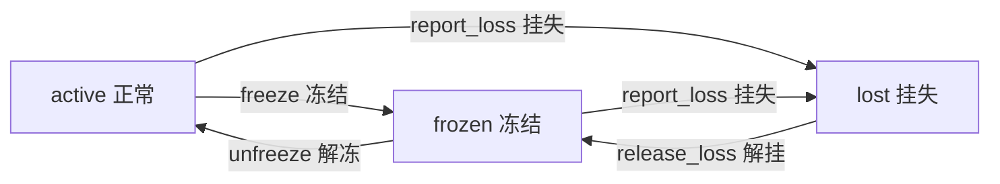
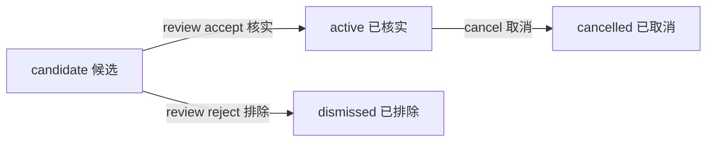

# E 卡片与订阅资料：2026-10-16 复核修订

由原 DOCX 提取为便于审阅的文字修订件，原稿保留。明确文字/样例错误已修正；未决规则均标出。

核验结论：卡片第一包资料齐全，A已补6项E数据检查并复跑现有卡片/页面测试。订阅最低材料结构齐全，但完整识别尚缺边界定义。详见[勘误](../../../docs/成员资料勘误.md)与[复测证据](../../../docs/evidence/2026-10-16-material-retest.json)。

订阅P组按商户合并；每个N组是独立模拟场景，不能将正反例全部混成同一账户历史。只出现P-1一笔时不足以成为候选，P-1/P-2配对后才满足至少两次条件。N-2修订仅调整虚构反例日期，原9/05→10/06仍可保留为“晚1天应识别”的正例。

仍需E明确：5%按哪个金额计算；可纳入哪些交易类型/方向；月末锚定日、闰日、容差跨月及下次扣费日期的推算。无别名表时只能做精确匹配范围，不能猜商户别名。

E 部分交付材料：卡片/订阅规则与交互文案

负责人：E

版本：E-V1.0

日期：2026-10-16

对应阻塞条目：BLOCKERS.md 的 E-001；接口口径：共享 v1.1；状态约束：shared/services.py

依据：五人分工 E1—E6；下一阶段开工与并行方案第 4 节

说明：本包只提供规则、数据、文案与验收预期，不要求 E 写代码；字段、金额单位、枚举全部沿用接口 v1.1，未自行新增季度等周期枚举。金额一律为整数分（1 元 = 100 分）。

原稿图1的解冻、review reject箭头位置易被误读为非法转换；以下按shared/services.py重列正确图示（勘误E-06）。卡状态操作均需模拟强验证；订阅动作需确认。

lost不能直接unfreeze；review reject只适用于candidate，不存在cancelled→dismissed。图示是既定状态规则，不代表未实现的订阅业务已可执行。

## 1. 本轮交付范围

| 包 | 内容 | 解锁什么 |
| --- | --- | --- |
| 第一包（本次） | 三张虚构卡（active/frozen/lost）及账户绑定、四动作前置/结果、四类确认文案、四个状态预期；card.apply 申请资格、card.set_limit 限额范围、支付动作与卡关联 | 替换工程模拟卡；卡片管理成员独立验收；支付限制规则进入 B 复核 |
| 第二包（本次，识别边界部分待确认） | 订阅识别正反例、归组/次数/周期/金额容差、候选与已知订阅表、核实/排除/取消/提醒预期与文案 | 提供订阅流程依据；自动识别仍待容差基数、日期推算等边界确认 |
| 后续 | 生日商品表、地址标签、下单/配送/提醒日期与中断剧本（E4）；录屏视频与简介（E6） | 第三轮生日链路与答辩 |

## 2. E1 卡片规则

### 2.1 三张虚构卡（第一包）

三张卡覆盖全部 card_state 枚举，绑定现有 demo 模拟账户 demo_account_a（模拟用户 A，余额 200000 分）；不得把 C 资料只读信用卡当作可付款卡。限额本轮仅作为已提供数据展示，不实现限额修改。

| card_id | account_id | 初始状态 | 展示名称 | 限额（分） | 限额（元） |
| --- | --- | --- | --- | --- | --- |
| CARD-E001 | demo_account_a | active | 模拟白金卡 | 50000 | 500.00 |
| CARD-E002 | demo_account_a | frozen | 模拟普通卡 | 20000 | 200.00 |
| CARD-E003 | demo_account_a | lost | 模拟挂失卡 | 30000 | 300.00 |

建议 A 替换现有 sample_card_active/frozen/lost 种子时保留同结构：card_id、account_id、card_state、limit_minor。

### 2.2 四动作状态机（沿用 shared/services.py，E 不重定义）

| 动作 | 允许原状态 | 成功后状态 | 权限 | 恢复方式 |
| --- | --- | --- | --- | --- |
| card.freeze | active | frozen | 红色（模拟强验证） | unfreeze |
| card.unfreeze | frozen | active | 红色（模拟强验证） | — |
| card.report_loss | active、frozen | lost | 红色（模拟强验证） | release_loss → frozen，再 unfreeze → active |
| card.release_loss | lost | frozen | 红色（模拟强验证） | 解挂后仍为 frozen，需另行 unfreeze |

### 2.3 四个状态预期（至少，含边界拒绝）

| 编号 | 前置 | 操作 | 预期结果 | 文案/状态 |
| --- | --- | --- | --- | --- |
| E-C1 | CARD-E001（active） | card.freeze | succeeded；状态 frozen | 「已冻结」 |
| E-C2 | CARD-E002（frozen） | card.unfreeze | succeeded；状态 active | 「已解冻」 |
| E-C3 | CARD-E003（lost） | card.unfreeze | 拒绝：error.code=INVALID_STATE；状态仍 lost | 「挂失中的卡片不能直接解冻」 |
| E-C4 | CARD-E003（lost） | card.release_loss | succeeded；状态 frozen（不是 active） | 「已解挂，卡片仍处于冻结状态」 |

补充：重复点击同一动作（同幂等键）应重放原回执，不重复变更；未授权、拒绝、过期、错用户均不改状态；重启后状态与记录可恢复（已由 A 自动测试覆盖，E 不重测技术细节）。

### 2.4 card.apply 申请规则（待 A 实现，本轮 E 定规则）

申请资格：模拟用户必须持有目标账户（归属校验），且账户余额非负（沿用既有模型）。

重复申请：同一账户已有 active 状态卡片时，拒绝再次申请，error.code=INVALID_STATE，文案「该账户已有正常使用的卡片」；已存在申请结果（幂等键）时重放原回执。

申请结果：application_id 仅代表申请已受理，不代表获批；正式获批/发卡不在本轮（保持“申请不等于获批”）。

权限：黄色（确认），不升级为红色；不立即创建新卡片。

### 2.5 card.set_limit 限额规则（待 A 实现，本轮 E 定规则）

范围：limit_minor 为非负整数分，上限 1000000（10000 元），下限 0（0 元，即不允许支付）。

周期：立即生效（模拟）；不按账单周期生效。

受限状态：任意状态可设置限额（frozen/lost 也可改），但支付动作的限额判断以执行时卡状态为准：非 active 卡即使限额达标也拒绝支付。

权限：红色（模拟强验证）。

校验：结果 limit_minor 必须与请求一致（接口已强制）。

### 2.6 支付动作与卡的关联（E 定规则，B 复核，后续付款模块执行）

关联范围：merchant.order（商户下单）是卡片绑定的支付动作候选；transfer.create 走账户资金，不受卡状态/限额约束。

状态约束：卡为 frozen 或 lost 时，拒绝使用该卡支付（error.code=INVALID_STATE，文案「卡片不可用于支付」）。

限额约束：单笔金额 > 卡 limit_minor 时拒绝（error.code=LIMIT_EXCEEDED，文案「超出卡片限额」）。

说明：本轮四动作已完成，支付限制尚未联动；上述规则进入 B 复核，A 在付款模块实现时接入。card_id 与 account_id 的绑定以卡表记录为准（B 复核支付关联）。

## 3. E2 订阅规则

### 3.1 识别参数（E 定，C 提供流水后自动识别用）

| 参数 | 取值 | 说明 |
| --- | --- | --- |
| 归组依据 | merchant_name 精确匹配（大小写不敏感），或按 E 提供的商户别名表归组 | 同商户不同商户名需在别名表列出 |
| 最少重复次数 | 同一商户在同一账户 ≥2 次扣费记录 | 单笔“会员”备注不足以断定周期扣费 |
| 周期允许偏差 | weekly ±1 天；monthly 自然月同日 ±3 天；yearly 相邻年度同月同日 ±10 天 | 现有公开周期仅 weekly/monthly/yearly，不新增枚举 |
| 金额容差 | 相邻周期金额差 ≤ 5%（向下取整到分）；5%的基数待E明确，暂不据此编码 | 涨价/优惠容差，超过则视为非订阅或需人工 |
| 月末/年付处理 | 扣费日超过当月天数时按当月最后一天归属；yearly 按日历同月同日 | 月末先落到当月最后一天；±3天能否跨月、锚定日是否漂移及闰日处理待E确认；年付不按12期拆分 |
| 缺少历史 | 仅 1 次记录或间隔不符 → 不识别 | 保留人工候选标记，不自动断言 |

### 3.2 应识别的正例（虚构流水）

| 样例 | 账户 | 商户 | 金额（分） | 日期 | kind | 识别结果 |
| --- | --- | --- | --- | --- | --- | --- |
| P-1 | demo_account_a | 模拟影音会员 | 2500 | 2026-08-05 | subscription | candidate |
| P-2 | demo_account_a | 模拟影音会员 | 2500 | 2026-09-05 | subscription | candidate |
| P-3 | demo_account_a | 模拟影音会员 | 2500 | 2026-10-05 | subscription | candidate |
| P-4 | demo_account_a | 模拟云存储 | 6800 | 2026-08-01 | subscription | candidate |
| P-5 | demo_account_a | 模拟云存储 | 6800 | 2026-09-01 | subscription | candidate |

P-1—P-3 归为候选订阅（merchant=模拟影音会员，monthly，2500 分）；P-4—P-5 归为候选订阅（merchant=模拟云存储，monthly，6800 分）。相邻月同日 ±3 天内、金额一致 → 识别。

### 3.3 不应识别的反例

| 样例 | 账户 | 商户 | 金额（分） | 日期 | 不识别原因 |
| --- | --- | --- | --- | --- | --- |
| N-1 | demo_account_a | 模拟视频站 | 2500 | 2026-10-05 | 仅 1 次记录，无历史配对 |
| N-2 | demo_account_a | 模拟影音会员 | 2500 | 2026-09-05 / 2026-10-09 | 修订模拟反例：预期10/05，实际10/09晚4天，超出±3天。原10/06仅晚1天，应为正例。 |
| N-3 | demo_account_a | 模拟云存储 | 6800 / 7200 | 2026-09-01 / 2026-10-01 | 金额差 400 分 > 5% 容差 |
| N-4 | demo_account_a | 模拟云存储 | 6800 | 2026-08-01 / 2026-10-01 | 间隔 61 天，不符 monthly |

### 3.4 候选与已知订阅表（第二包）

| subscription_id | account_id | merchant_name | amount_minor | interval | next_charge_date | subscription_state | evidence |
| --- | --- | --- | --- | --- | --- | --- | --- |
| SUB-E001 | demo_account_a | 模拟影音会员 | 2500 | monthly | 2026-11-05 | candidate | 流水 P-1/P-2/P-3 |
| SUB-E002 | demo_account_a | 模拟云存储 | 6800 | monthly | 2026-11-01 | candidate | 流水P-4/P-5只到9/01；11/01为原稿给定展示值，推算依据待E确认，不能当作自动检测预期 |
| SUB-E003 | demo_account_a | 模拟健身年卡 | 120000 | yearly | 2027-01-10 | active | 已知订阅（已核实） |

说明：SUB-E003 为已知 active 订阅，用于取消与提醒流程测试，不由候选识别生成。

### 3.5 核实 / 排除 / 取消 / 提醒（沿用既定转换，E 给预期与文案）

| 动作 | 前置 | 决策/参数 | 结果 | 文案 |
| --- | --- | --- | --- | --- |
| subscription.review | candidate | accept | active | 「已核实并确认订阅」 |
| subscription.review | candidate | reject | dismissed | 「已排除候选订阅；不改变既有扣费」 |
| subscription.cancel | active | — | cancelled | 未来业务验收预期：取消后停止后续模拟扣费；当前订阅/扣费联动未实现，尚不能展示成功文案 |
| subscription.remind | active | remind_at | 登记提醒任务 | 「已安排续费提醒」 |

排除（dismissed）不等于取消代扣；取消只允许 active→cancelled；候选核实不代表新签授权。

提醒任务登记复用公共调度（validate_task_spec 的 notify_subscription），不另建调度器。

## 4. E3 页面与交互文案

### 4.1 卡片四类确认文案

| 动作 | 确认文案（页面/待确认） |
| --- | --- |
| 冻结 | 当前演示文案：确认冻结“{展示名称}（{card_id}）”？验证通过后改为冻结状态。支付限制尚未联动；解冻需再次验证。 |
| 解冻 | 当前演示文案：确认解冻“{展示名称}（{card_id}）”？验证通过后改为正常状态。支付能力待后续联动验收。 |
| 挂失 | 确认挂失“{展示名称}（{card_id}）”？验证通过后改为挂失状态；恢复正常状态需先解挂、再解冻。 |
| 解挂 | 确认解挂“{展示名称}（{card_id}）”？验证通过后仍为冻结状态，需要另行解冻。 |

### 4.2 订阅文案

| 场景 | 文案 |
| --- | --- |
| 候选列出 | 「发现可能的周期扣费：{merchant_name} 每{周期} {金额}元，最近扣费 {日期}。」 |
| 核实接受 | 「确认订阅 {merchant_name}（{金额}元/周期）？」 |
| 排除 | 「已排除 {merchant_name}；如确有扣费请单独核实，不自动取消。」 |
| 取消 | 「确认取消订阅 {merchant_name}？取消后将停止后续模拟扣费，不可恢复本期已扣。」 |
| 提醒 | 「续费提醒：{merchant_name} 将于 {日期} 扣费 {金额}元。」 |

### 4.3 状态文案表（沿用 STATUSES，E 确认展示口径）

| status | 文案 | 卡片/订阅适用 |
| --- | --- | --- |
| succeeded | 已完成 | 四动作/核实/取消 |
| awaiting_confirmation | 待用户确认 | 黄色动作（apply、subscription 系） |
| awaiting_verification | 待强验证 | 红色动作（freeze/set_limit 等） |
| failed | 执行失败 | 执行失败路径；用户主动拒绝应为cancelled，不能一律记failed |
| unknown | 结果待核实 | 写后超时恢复 |
| blocked | 已阻止 | 安全锁定等阻断；当前网关越权为failed/FORBIDDEN，非法卡状态为failed/INVALID_STATE |

## 5. E4 生日素材（后续交付，预留框架）

商品表：item_id、名称、价格（分）、类别（鲜花/蛋糕）；虚构 ID 不与地址文字混用。

地址标签：delivery_address_id、label（如「家里」「公司」）；不用地址文字冒充 ID。

日期：下单日、配送日（deliver_on）、提醒日，与 B 预算/定时规则配合；过去日期重选；中断时先核实未知订单。

交付剧本：正常下单 → 逐步状态 → 中断 → 释放可确认未用预算 → 人工接管。

## 6. E5 体验验收清单（A 接入后由 E 执行）

A已按本轮资料在临时库执行E-C1—E-C4及两条挂失路径，共6项通过；真实卡片页面/刷新另有既有测试复跑。日志和JSON已补，不再为缺截图退回E。

确认文案出现在提交前；红色动作出现待强验证；重复点击不重复变更。

挂失卡支付被拒、超限额支付被拒（待付款模块接入后）。

候选订阅列出、accept→active、reject→dismissed、active→cancelled 全流程实测。

取消后模拟不再产生后续扣费；提醒任务登记可见。

可本地复现的验收由A直接测试留档，注明版本、数据和实际结果；订阅、支付、提醒等未实现功能仍待实现后验收。

## 7. 待 A 编码与 B 复核事项

| 事项 | 负责人 | 说明 |
| --- | --- | --- |
| 将 CARD-E001—E003 替换 sample_card 种子 | A | 保持卡表结构与既有测试 |
| 实现 card.apply / card.set_limit（按 2.4/2.5） | A | 黄/红权限分别接入网关 |
| 支付动作按 2.6 联动卡状态与限额 | A | 待 B 复核规则后实现 |
| 订阅识别按 3.1 参数实现 | A | 需 C 提供流水；识别结果标 candidate |
| 订阅 review/cancel/remind 接入公共调度 | A | 提醒复用 notify_subscription |
| 复核支付关联与限额范围 | B | 资金口径复核 |

## 8. 待确认项（不影响第一包开工）

三张卡和限额作为本轮E明确标记的模拟样例，A已临时加载验证，不再重复索要。正式替换日常演示种子属于后续接入。

SUB-E003已明确为120000分的已知active模拟订阅，可用于流程测试；不据此声称自动识别已实现。

现有merchant.order只有account_id，没有card_id；同账户3张卡不能推断支付用卡。E/B须明确可在现接口下执行的选卡/默认绑定规则；确需变更共享接口则由A统一协调，不能擅加字段。
